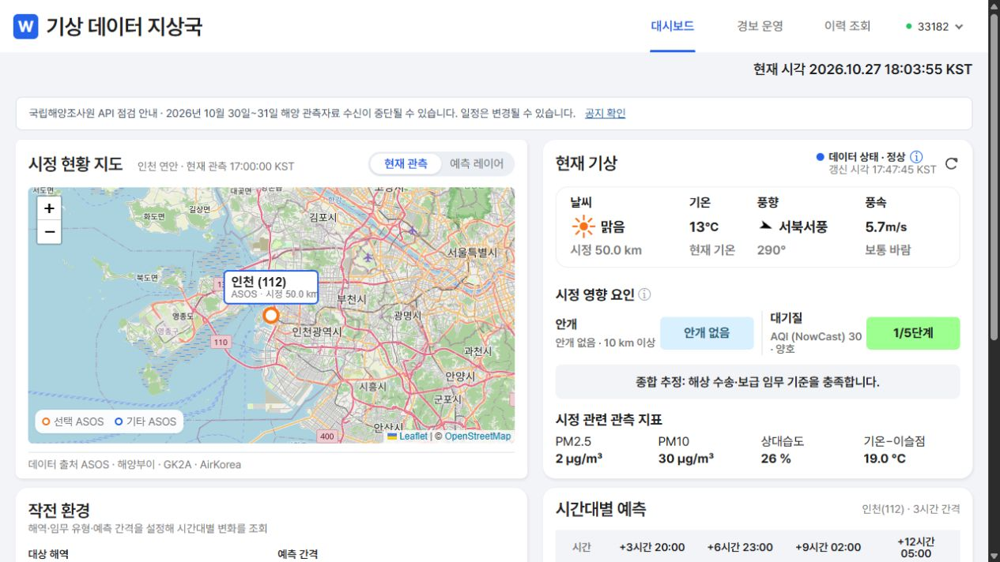
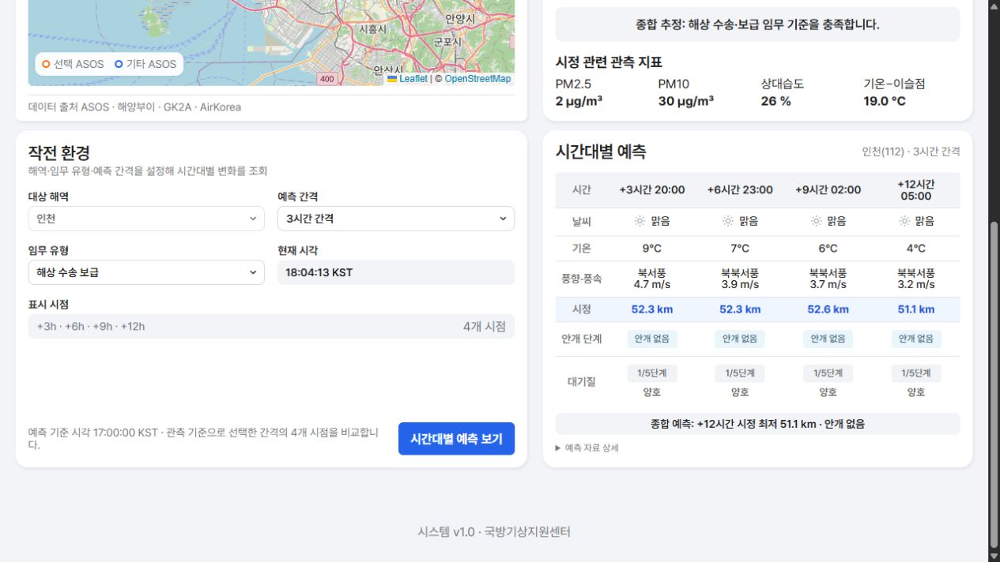
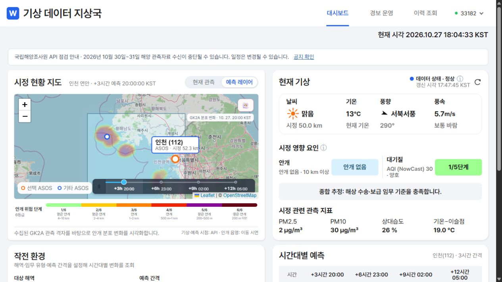
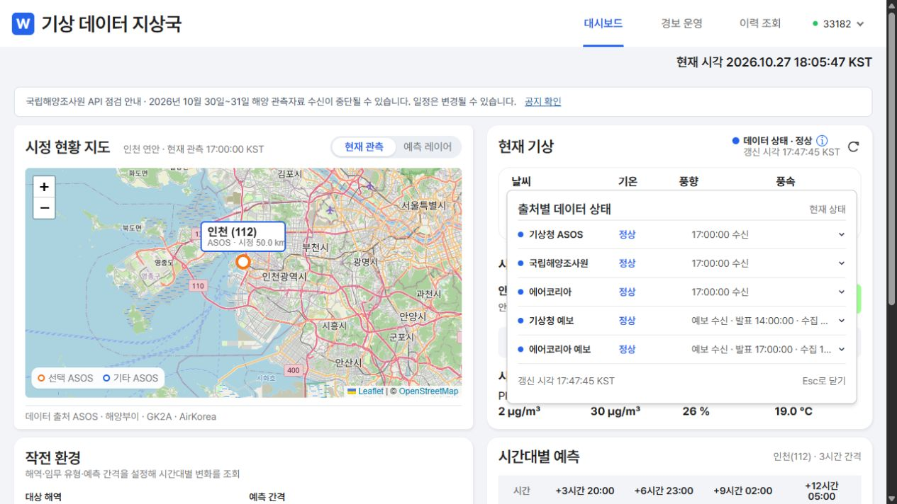
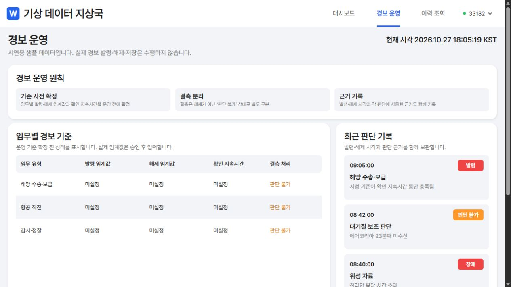
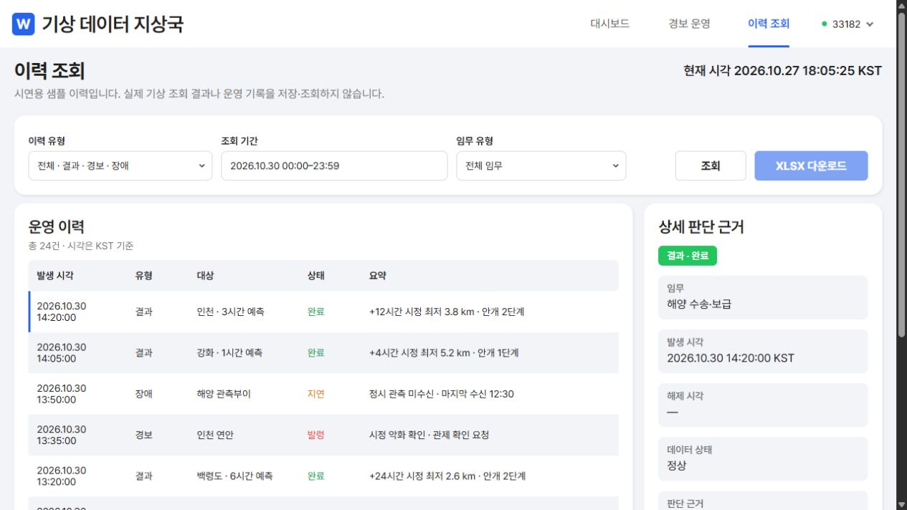
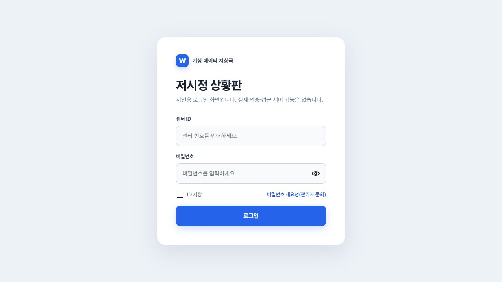

# 기상 데이터 지상국

**관측과 예측 자료를 한 화면에서 살펴보는 저시정 상황판**

관측소별 기상·대기질 자료를 확인하고, 선택한 간격에 따른 시정과 대기질 예측을 비교합니다. 외부 자료의 수신 상태와 관측 시각도 함께 표시합니다.

> 로그인·경보 운영·이력 조회는 시연용 화면입니다. 실제 인증이나 경보 발령·운영 이력 저장을 수행하지 않습니다. 예측 지도에 표시되는 안개 분포도 이동 시연용입니다.

## 주요 화면

화면은 2026년 10월 27일 로컬 실행 상태를 캡처한 예시입니다. 현재 기상·예측 화면은 실제 API 응답을 사용했고, 경보·이력은 시연용 샘플을 사용했습니다. 관측값과 예측값은 조회 시점에 따라 달라집니다.

### 현재 기상과 시정 현황

지도에서 ASOS 관측소를 선택하고 시정, 기온, 풍향·풍속, 안개 단계와 대기질을 확인합니다. 시정 영향 요인과 관측 지표도 함께 표시합니다.



### 시간대별 예측

선택한 해역·임무·예측 간격에 따라 4개 시점의 날씨, 기온, 바람, 시정, 안개 단계와 대기질을 비교합니다. 예측 대기질은 모델 PM 예측값에 기반한 추정값이며 관측 NowCast와 구분합니다.



### 안개 분포 예측 레이어

예측 시점을 선택하거나 재생하면서 안개 분포의 움직임을 살펴봅니다. 지도 음영은 기존 GK2A 관측 격자를 활용한 **이동 시연**이며, 실제 안개 예측 결과는 아닙니다.



### 출처별 데이터 상태

기상청·에어코리아·국립해양조사원 자료의 상태와 관측·발표·수집 시각을 확인합니다. 일부 출처가 실패해도 가능한 자료를 표시하며, 실패한 출처만 다시 요청할 수 있습니다.



### 경보 운영 · 시연용

경보 운영 원칙, 임무별 기준과 판단 기록을 샘플로 보여줍니다. 실제 경보 발령·해제·저장은 수행하지 않으며 기준 편집과 승인 요청은 비활성화돼 있습니다.



### 이력 조회 · 시연용

샘플 이력을 유형과 임무로 살펴보고 판단 근거를 확인합니다. 실제 운영 이력 저장·조회 및 XLSX 다운로드는 제공하지 않습니다.



### 로그인 · 시연용

시연용 ID와 코드로 대시보드에 진입합니다. 이 화면은 실제 인증·인가 기능이 아닙니다.



## 구성

| 영역 | 사용 기술과 역할 |
| --- | --- |
| 프론트엔드 | React · TypeScript · Vite, Leaflet 지도 |
| 백엔드 | Python · FastAPI, 외부 관측·예보 API 수집 |
| 예측 | `backend/models/forecast_tuned/`의 CatBoost 모델로 시정·PM2.5·PM10 예측 |
| 배포 준비 | Docker Compose · Nginx, 프론트 정적 파일과 API 프록시 |

일반 최신 조회는 DB 없이 실행합니다. 출처가 실패하면 가능한 결과와 누락 상태를 표시합니다. 이전 정상값은 조건에 따라 최대 2시간 재사용하며, 캐시는 프로세스 메모리에만 있어 재시작 시 사라집니다.

> 실행 명령은 프론트·백엔드 및 배포 구성이 함께 반영된 저장소를 기준으로 합니다.

## 로컬 실행

사전 준비: Git, Python 3.13, Node.js 22, pnpm 10.15.1. 아래 명령은 저장소 루트에서 시작한다. 외부 API 활용 승인이 있는 키가 필요하다. 키 값은 채팅이나 Git에 공유하지 않는다.

### 1. 백엔드

**PowerShell**

```powershell
python -m venv .venv
.\.venv\Scripts\python.exe -m pip install -r requirements-backend.txt
$env:PYTHONUTF8 = '1'
$env:PYTHONIOENCODING = 'utf-8'
$env:KMA_API_KEY = [System.Net.NetworkCredential]::new('', (Read-Host '기상청 API 허브 키' -AsSecureString)).Password
$env:DATA_API_KEY = [System.Net.NetworkCredential]::new('', (Read-Host '공공데이터포털 키' -AsSecureString)).Password
.\.venv\Scripts\python.exe -m uvicorn backend.main:app --host 127.0.0.1 --port 8000
```

**Bash** (Windows Git Bash 또는 Linux)

```bash
python -m venv .venv
if [ -x .venv/Scripts/python.exe ]; then
  PROJECT_PYTHON=./.venv/Scripts/python.exe
else
  PROJECT_PYTHON=./.venv/bin/python
fi
"$PROJECT_PYTHON" -m pip install -r requirements-backend.txt
export PYTHONUTF8=1 PYTHONIOENCODING=utf-8
read -rs -p '기상청 API 허브 키: ' KMA_API_KEY; printf '\n'
read -rs -p '공공데이터포털 키: ' DATA_API_KEY; printf '\n'
export KMA_API_KEY DATA_API_KEY
"$PROJECT_PYTHON" -m uvicorn backend.main:app --host 127.0.0.1 --port 8000
```

`KMA_AUTH_KEY`가 지정되면 ASOS 수집에 우선 사용한다. `AIRKOREA_API_KEY`를 별도로 설정하면 에어코리아 호출에 우선 사용하며, 없으면 `DATA_API_KEY`를 사용한다. 공공데이터포털 키는 기상청 단기예보·에어코리아·국립해양조사원 API 이용 권한이 필요하다. PM1 수집도 `DATA_API_KEY`를 사용하며 기존 `PM1_API_KEY`만 설정한 환경은 호환된다. `KMA_API_KEY`는 ASOS 및 단기예보 대체 경로에 필요한 API 허브 사용 권한이 필요하다. 인증값에 따라 실제 사용 가능 여부를 확인한다.

- 상태 확인: <http://127.0.0.1:8000/api/health>
- Swagger: <http://127.0.0.1:8000/docs>
- 로그는 서버를 실행한 터미널에 출력된다. 별도 파일로 리디렉션한 경우 PowerShell에서는 `Get-Content <로그경로> -Encoding UTF8 -Tail 50 -Wait`, Bash에서는 `tail -n 50 -f <로그경로>`로 확인한다.

### 2. 프론트엔드

백엔드를 실행 중인 창과 별도의 터미널을 열고 저장소 루트에서 실행한다.

**PowerShell**

```powershell
cd frontend
corepack enable
corepack prepare pnpm@10.15.1 --activate
pnpm install --frozen-lockfile
pnpm dev:backend --port 5174 --strictPort
```

**Bash** (Windows Git Bash 또는 Linux)

```bash
cd frontend
corepack enable
corepack prepare pnpm@10.15.1 --activate
pnpm install --frozen-lockfile
pnpm dev:backend --port 5174 --strictPort
```

<http://127.0.0.1:5174/>에 접속한다. `/api`는 로컬 8000번 백엔드로 프록시된다. 시연 로그인은 센터 ID `33182`, 비밀번호 `100005`다. 이 값은 공개된 시연용이며 인증·인가가 아니다. 백엔드 서버는 별도로 실행해야 한다.

화면에서 ASOS를 선택하고 예측 간격과 임무를 고른 뒤 **시간대별 예측 보기**를 누른다. 출처별 상태에서 실제 관측 시각과 수집 오류를 확인한다. 프론트엔드 검증은 `pnpm typecheck`, `pnpm test`, `pnpm build`, `pnpm build-storybook`으로 실행한다.

## Docker 배포 준비 (NCP 및 다른 서버)

### 전제

- 프론트엔드, 백엔드 및 이 배포 구성이 함께 반영된 커밋에서 진행한다.
- 이 문서는 NCP 서버를 기준으로 작성했지만 Docker Engine과 Compose를 실행할 수 있다면 다른 클라우드 서버나 개인 VM에서도 같은 구성을 사용할 수 있다. NCP 계정이나 개인 소유 서버가 필수는 아니다.
- 서버 운영체제·CPU 아키텍처와 Docker 이미지 호환성, 외부 API와 지도 타일에 대한 인터넷 연결을 사용 환경에서 확인한다. 서버, 방화벽·접근 규칙, 도메인·HTTPS는 이 저장소가 설정하지 않는다.
- 시연 로그인은 접근 통제가 아니다. **인증 및 네트워크 접근 제한 없이 인터넷에 공개하지 않는다.** 클라우드의 접근 규칙이나 VM 방화벽과 인증된 역방향 프록시를 사용 환경에 맞게 구성한다.
- 프론트 Nginx가 정적 빌드 파일을 제공하고 같은 주소의 `/api/`를 내부 FastAPI 컨테이너로 전달한다. API 서버는 호스트 포트에 직접 노출하지 않는다.

### 서버에서 실행

저장소 루트의 `.env`에 승인된 API 키를 설정한다. 이 파일은 비밀정보이므로 Git에 추가하거나 이미지에 복사하지 않는다. 기존 환경변수 방식도 사용할 수 있다. 최소한 `KMA_API_KEY`와 `DATA_API_KEY`가 필요하며, 필요 시 `KMA_AUTH_KEY`와 `AIRKOREA_API_KEY`를 별도로 설정한다.

```sh
docker compose config --quiet
docker compose up -d --build
docker compose ps
curl -f http://127.0.0.1:8080/api/health
docker compose logs -f --tail=100 backend
```

기본 설정은 호스트 `127.0.0.1:8080`에서만 접근 가능하다. 외부 접근은 HTTPS와 인증·접근 제한을 갖춘 호스트 역방향 프록시를 연결한 뒤 설정한다. `docker compose down`은 이 두 컨테이너를 중지·제거하며, DB는 이 구성에 포함되지 않는다.

NCP를 비롯한 다른 클라우드나 개인 VM에서 원격 접속을 허용하려면 해당 환경의 방화벽·네트워크 설정과 역방향 프록시를 별도로 준비해야 한다. 로컬 PC Docker에서 이미지 빌드와 API 연결을 확인했으며, 다른 클라우드나 개인 VM에서의 배포는 아직 검증하지 않았다.

빌드된 프론트는 demo 모드다. 지도 타일은 외부 OpenStreetMap, 관측·예보는 각 기관 API에 접근해야 한다. 출처별 서비스 장애 및 요청 제한은 별도로 확인한다. 국립해양조사원은 [2026년 10월 30~31일 API 중단을 공지](https://www.data.go.kr/bbs/ntc/selectNotice.do?originId=NOTICE_0000000005103)했으며 일정은 변동될 수 있다.

## 검증과 운영 한계

- 서버 상태 API의 성공은 외부 API나 예측까지 모두 정상이라는 뜻이 아니다. 실제 관측소·간격별 대시보드 요청과 화면을 별도로 확인한다.
- API 키는 서버 환경변수로 주입한다. 프론트 빌드 변수, 로그, 이미지, Git에 넣지 않는다.
- 입력 누락 상태의 예측은 모델이 계산할 수 있는 항목만 제공한다. 화면 표시는 예측 정확도 검증이 아니다.
- 저장소 규칙과 브랜치 절차는 [AGENTS.md](AGENTS.md)를 따른다.
